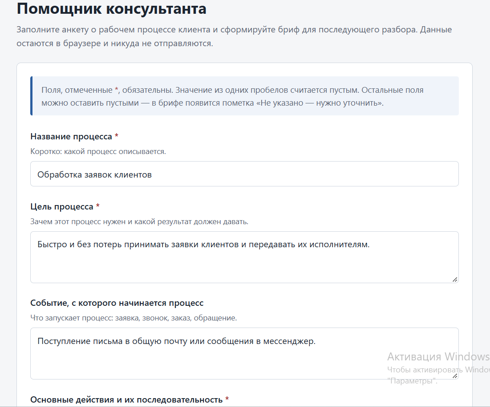
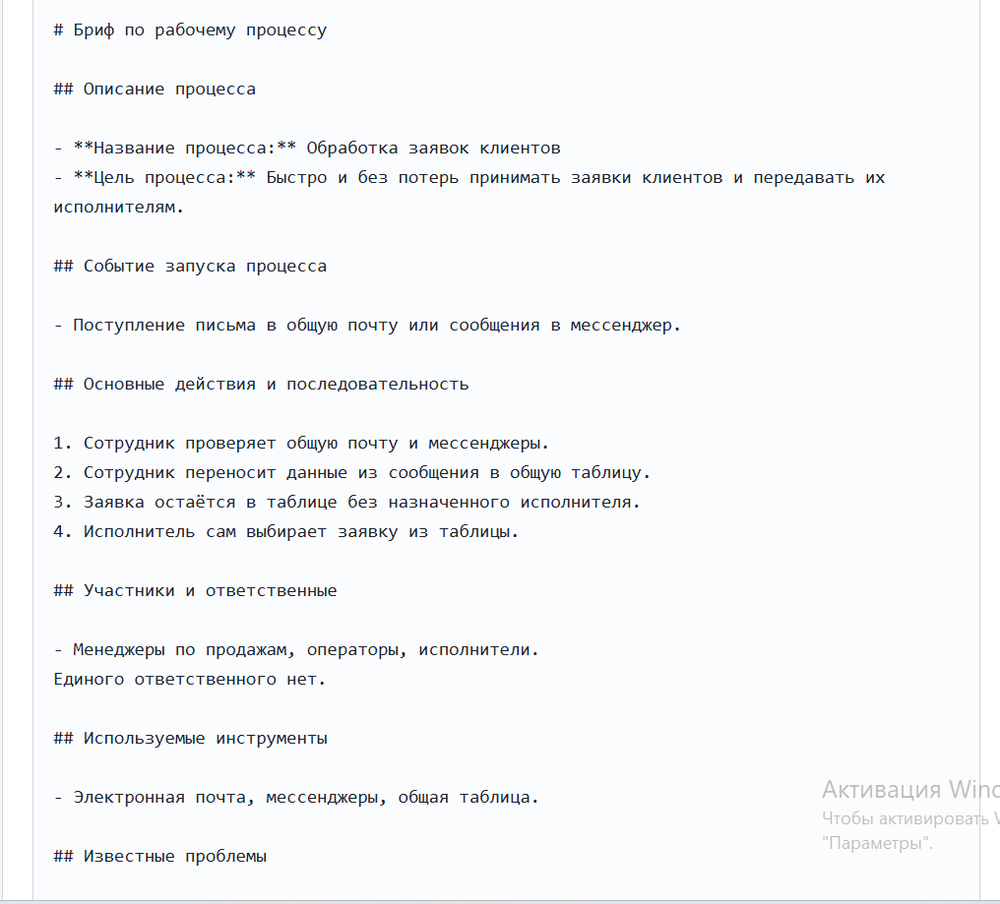
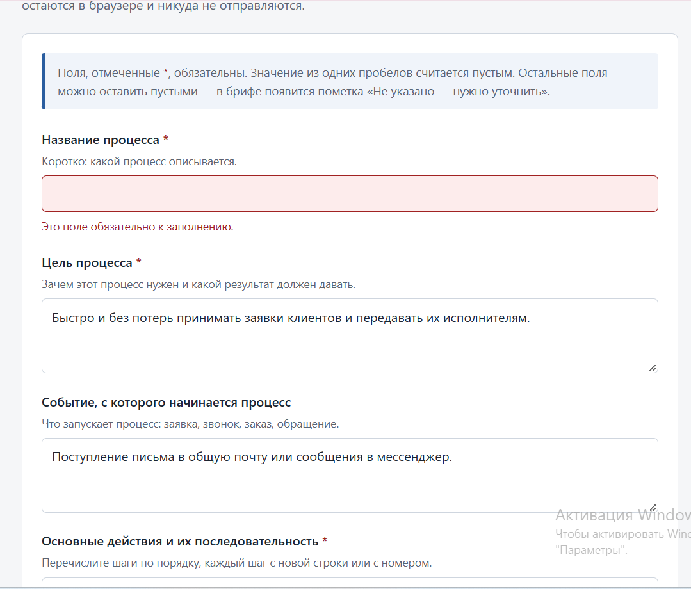

# Помощник консультанта — локальный MVP

Простое локальное приложение для сбора анкеты о рабочем процессе и формирования брифа.

## Задача

Автоматизировать сбор и структурирование исходных данных о процессе перед консультацией по улучшению бизнеса.

## Функции

- Анкета на русском языке со всеми полями из описания (название, цель, событие, шаги, участники, инструменты, проблемы, желаемый результат).
- Явно обозначенные обязательные поля (звёздочка `*`).
- Проверка: значения из одних пробелов считаются пустыми.
- Для необязательных незаполненных полей в брифе появляется «Не указано — нужно уточнить».
- Формирование и отображение текстового брифа в формате Markdown.
- Кнопка загрузки учебного примера.
- Кнопка «Скачать бриф»: скачивает показанный бриф в файл `process-brief.md` в кодировке UTF-8. Кнопка доступна только после успешного формирования брифа и отключается, если форма изменилась после формирования.

## Как запустить

1. Убедитесь, что установлен Python 3.
2. Откройте терминал в корне проекта (папка с `index.html`, `styles.css` и `app.js`).
3. Запустите локальный сервер:
   ```powershell
   python -m http.server 8000 --bind 127.0.0.1
   ```
4. Откройте браузер и перейдите по адресу: [http://127.0.0.1:8000](http://127.0.0.1:8000)
5. Используйте форму: заполняйте поля, нажимайте кнопки.

## Учебный пример

Нажмите кнопку **«Загрузить учебный пример»** — поля анкеты заполнятся вымышленными данными из описания проекта. Это ускорит знакомство с возможностями приложения.

## Ограничения

- HTML, CSS и JavaScript без сторонних библиотек и сборки.
- Приложение не отправляет данные во внешние сервисы — всё остаётся в браузере. При облачном анализе бриф передаётся провайдеру модели.
- Интерфейс и материалы — на русском языке.
- Анализ и разбор процесса выполняется отдельно в Claude Code (скилл входит в репозиторий проекта и вызывается отдельно от браузерного приложения).
- Нет автосохранения между сеансами: после закрытия страницы данные теряются. Перед закрытием страницы скачайте бриф. Идея автосохранения — после сдачи, см. [IDEAS.md](IDEAS.md).

## Проверка

- Обязательные поля: если оставить пустым или написать только пробелы — появится сообщение об ошибке.
- Незаполненные необязательные поля: в брифе появится пометка «Не указано — нужно уточнить».
- Пользовательский текст отображается как обычный текст (HTML-теги не работают).
- После изменения полей и повторного формирования бриф обновляется.
- Скачивание: кнопка «Скачать бриф» доступна после успешного формирования и отключается при изменении формы до повторного формирования.

## Скилл разбора

- Файл скилла: [SKILL.md](.claude/skills/process-review/SKILL.md).
- Вызов в Claude Code: введите `/process-review` и укажите путь к брифу, например `examples/full-flow-brief.md`; для сохранения результата укажите файл, например `examples/full-flow-review.md`.
- Примеры полного сценария: [учебный бриф](examples/full-flow-brief.md) и [предварительный разбор](examples/full-flow-review.md).

## Документы проекта

- [Описание проекта](PROJECT.md).
- [План и текущее состояние](PLAN.md).
- [Результаты проверок](CHECKS.md).

## Подготовка к сдаче

Приложение и скилл созданы; реальные скриншоты добавлены ниже. Перед сдачей осталось опубликовать репозиторий через GitHub CLI и проверить доступ преподавателя. Подготовлен перенос проекта в GitHub Codespaces; публикация пока не выполнена.

## Скриншоты приложения

### Заполненная анкета



### Сформированный бриф



### Проверка обязательных полей


